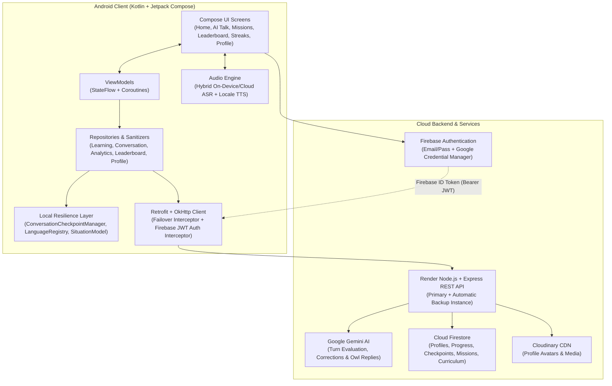

# MacaoAI — AI-Powered Conversational Language Learning App (Android)

[](https://developer.android.com)
[](https://kotlinlang.org)
[](https://developer.android.com/jetpack/compose)
[-blue)](https://developer.android.com/about/versions/nougat)
[](https://developer.android.com)
[](#supported-languages-20-global-languages)

**MacaoAI** is a voice-first, AI-powered Android language learning platform built with **Kotlin** and **Jetpack Compose**. Designed around real-world speaking fluency rather than passive tapping, MacaoAI combines an **infinite AI voice conversation tutor** (powered by Google Gemini), **immersive real-world situation missions**, a **gamified learning path**, **streaks & fluency analytics**, **global leaderboards**, and **CEFR proficiency tracking** across **20 languages**.

---

## Table of Contents

1. [What Makes MacaoAI Unique](#1-what-makes-macaoai-unique)
2. [Core Features & User Journey](#2-core-features--user-journey)
   - [Authentication & Personalized Onboarding](#21-authentication--personalized-onboarding)
   - [Home: Gamified Learning Path & Vocabulary Practice](#22-home-gamified-learning-path--vocabulary-practice)
   - [Immersive Real-World Situation Missions](#23-immersive-real-world-situation-missions)
   - [AI Talk: Infinite Voice Conversation Tutor](#24-ai-talk-infinite-voice-conversation-tutor)
   - [Leaderboards: Global & Timeframe Rankings](#25-leaderboards-global--timeframe-rankings)
   - [Streaks & Fluency Analytics](#26-streaks--fluency-analytics)
   - [Profile, CEFR Proficiency & Account Management](#27-profile-cefr-proficiency--account-management)
3. [Supported Languages (20 Global Languages)](#3-supported-languages-20-global-languages)
4. [System Architecture & Engineering Highlights](#4-system-architecture--engineering-highlights)
5. [Tech Stack & Dependencies](#5-tech-stack--dependencies)
6. [Design System & Visual Identity](#6-design-system--visual-identity)
7. [Project Structure](#7-project-structure)
8. [Backend API Integration Overview](#8-backend-api-integration-overview)
9. [Getting Started & Local Development](#9-getting-started--local-development)
10. [Testing & Verification](#10-testing--verification)

---

## 1. What Makes MacaoAI Unique

Most language apps trap learners in repetitive multiple-choice drills. MacaoAI is engineered from the ground up for **active speaking and listening confidence**:

- **Voice-First Learning Loop:** Real-time Automatic Speech Recognition (ASR) with partial transcripts and native-voice Text-to-Speech (TTS) across 20 languages, including slow-speed (`0.75x`) playback and script/romanization dual matching.
- **Infinite, Non-Repeating AI Conversations:** Learners speak turn-by-turn with **Macao the Owl** across a structured 15-topic curriculum with anti-repetition memory, gentle contextual corrections, milestone rewards, and automatic cloud/local checkpoint resumption.
- **Real-World Situation Missions:** Interactive 5-step travel simulations (**Airport Arrival**, **Hotel Check-In**, **Pharmacy Counter**) localized to authentic regional contexts (e.g., Haneda Airport in Tokyo, Ryokan Sakura, Matsumoto Kiyoshi).
- **Production-Grade Resilience:** Built with primary/backup cloud backend failover, hybrid on-device + cloud ASR fallback, local + cloud checkpoint synchronization, and defensive analytics sanitization.

---

## 2. Core Features & User Journey

The application flows cleanly through four root destinations (`AppScreen`): **Splash** → **Onboarding & Auth** → **5-Step Profile Setup** → **MainApp** (featuring a floating pill-shaped 5-tab `BottomNavBar`: **Home**, **AI Talk**, **Leaderboard**, **Streaks**, **Profile**).

### 2.1. Authentication & Personalized Onboarding
- **Multi-Provider Authentication (`auth/`):**
  - **Email & Password** sign-up, sign-in, and password reset via Firebase Authentication.
  - **Google Sign-In** using AndroidX **Credential Manager** & Google ID (`GetSignInWithGoogleOption`).
  - **OTP Verification Flow** (`OtpSetupScreen`, `EnterOtpScreen`).
- **5-Step Profile Setup (`onboarding/ui/ProfileSetupFlow.kt`):**
  1. **Native Language Picker** (searchable across all 20 languages).
  2. **Target Learning Language Picker** (with native script & country flag).
  3. **Current Proficiency Assessment** (Beginner to Advanced).
  4. **Learning Motivation** (Travel, Career, Culture, Study, etc.).
  5. **Age Group Selection** (persists profile to Firestore/Backend).
  6. **Animated Curriculum Compilation** (`CompilingDataScreen` → `AllSetScreen`) before entering the main learning experience.

### 2.2. Home: Gamified Learning Path & Vocabulary Practice
- **S-Curve Learning Map (`HomeScreen.kt`, `LearningMapScreen.kt`):**
  - Visual island stages representing `COMPLETED`, `CURRENT`, and `LOCKED` levels along a winding path with interactive decorations (stars, chests, lightning, coins) and the user's avatar marker.
  - Server-driven progression rules (`POST /api/v1/progress/unlock`) verifying completed lesson thresholds and average accuracy scores before unlocking subsequent levels.
- **Interactive Speaking & Vocabulary Lessons (`LessonPracticeScreen.kt`, `LevelIntroScreen.kt`, `LessonCompleteScreen.kt`):**
  - Displays target word/phrase, romanization/pronunciation guide, translation, part of speech, and contextual example sentences.
  - Microphone capture evaluates spoken pronunciation (`IDLE` → `LISTENING` → `PROCESSING` → `CORRECT` / `INCORRECT`), awarding XP and updating daily streaks upon completion.

### 2.3. Immersive Real-World Situation Missions
Implemented in `SituationMissionScreen.kt` and `SituationModel.kt`, Situation Missions immerse learners in high-value travel scenarios (**Mission 1: Airport Arrival**, **Mission 2: Hotel Check-In**, **Mission 3: Pharmacy Counter**) through a unified 5-step workflow:

1. **Step 1 — Scene Intro & Audio Comprehension (`MissionSceneStep`):**
   - Scenario hero artwork (including localized Tokyo Haneda departure lounge art `airport_tokyo.jpg`, hotel reception, and pharmacy counter).
   - **"Listen Scene"** plays native-language audio (e.g., Tokyo gate announcement `"東京行きは24番ゲートからです。"`).
   - Contextual prompts (`ANNOUNCED GATE`, `SELECT YOUR GREETING`, `DESCRIBE YOUR SYMPTOMS`) with bilingual target-script + English translation cards. Tapping any card plays clean native TTS pronunciation.
2. **Step 2 — Place & Sign Pronunciation Practice (`MissionPronunciationStep`):**
   - Teaches essential local signage (e.g., *Airport, Railway Station, Bus Stop, Departures, Baggage Claim*).
   - Validates spoken attempts against both the native script and parenthetical romanization (`validateBeginnerSpeech`).
3. **Step 3 — Interactive Verification Grid (`MissionVerificationStep`):**
   - Visual grid where the host (*Flight Attendant*, *Concierge*, or *Pharmacist*) requests required documents or items (passport, headphones, room key, medication).
4. **Step 4 — Real-World Speaking Challenge (`MissionSpeakingStep`):**
   - Final roleplay challenge requiring the learner to speak a practical phrase (e.g., ordering coffee `"コーヒーをお願いします"`, requesting a room key, or asking for headache relief).
5. **Step 5 — Mission Accomplished Summary (`MissionCompleteStep`):**
   - Displays XP earned, accuracy score, star rating, acquired vocabulary/skills checklist, and a **Cultural Tip** specific to the destination country. Syncs completion state to the backend (`POST /api/v1/situations/missions/{missionId}/complete`).

### 2.4. AI Talk: Infinite Voice Conversation Tutor
Implemented across `ConversationScreen.kt`, `ConversationViewModel.kt`, `ConversationCurriculumManager.kt`, and `ConversationCheckpointManager.kt`:

- **Continuous Voice Dialogue with Macao the Owl:**
  - Powered by Google Gemini on the backend with anti-repetition prompt engineering and a synchronized **15-turn multi-topic progression bank** across all 20 languages:
    - *Milestone 1 (Turns 1–5):* Introduction → Origin → Occupation → Hobbies → Music
    - *Milestone 2 (Turns 6–10):* Food → Drinks → Weather → Daily Routine → Travel
    - *Milestone 3 (Turns 11–15):* Weekend → Studies → Pets → Sports → Future Goals
- **Real-Time Speech Evaluation & Coaching:**
  - Streams live partial speech recognition results as the user speaks.
  - Evaluates understanding and pronunciation accuracy (`0–100` score), offers gentle native corrections (`correction`) with retry support (`shouldRetry`), and replies naturally in character (`owlReply`) with text, romanization, and English meaning.
- **Persistent Checkpoints & Resumption:**
  - Automatically saves checkpoints after every turn to both **Firestore** (`GET /api/v1/conversation/checkpoint`) and **local storage** (`ConversationCheckpointManager`), tracking `currentTurn`, `milestoneLevel`, `recentHistory`, `usedSentences`, `accumulatedXp`, and `userMemory`.
  - Users can seamlessly resume an ongoing conversation across app restarts or trigger a clean reset (`POST /api/v1/conversation/reset`).
- **Accessible Audio Controls:**
  - Supports normal (`1.0x`) and **Slow Mode** (`0.75x`) TTS playback, automatically stripping parenthetical romanization so the TTS engine pronounces only pure native script.

### 2.5. Leaderboards: Global & Timeframe Rankings
Implemented in `LeaderboardScreen.kt`, `LeaderboardViewModel.kt`, and `LeaderboardRepository.kt`:

- **Timeframe Filtering:** Switch seamlessly between **Today**, **This Week**, and **All Time** (`GET /api/v1/leaderboard?timeframe=...`).
- **Top-3 Podium & Ranked List:** Features a podium showcase for the top 3 learners alongside a scrollable ranked list displaying avatars, country flags, XP points, and dynamic rank movement badges (`rankChange` up/down arrows).
- **Current User Pinning:** Highlights the signed-in user's standing and rank delta even when outside the top slots.

### 2.6. Streaks & Fluency Analytics
Implemented in `AnalyticsScreen.kt`, `AnalyticsViewModel.kt`, `AnalyticsRepository.kt`, and `AnalyticsSanitizer.kt`:

- **Date Strip & Weekly Activity:** Timezone-aware (`tzOffset`) calendar strip tracking daily study completion and daily XP.
- **Streak Engine:** Tracks **Current Streak**, **Longest Streak**, **Yearly Active Days** (out of 365), **Streak Freezes**, and a multi-week **Activity Heatmap**.
- **Hero Metrics:** Aggregates Total XP, Lessons Completed, Minutes Studied, and Points.
- **Weekly Progress Chart:** Normalized bar chart (`weeklyBars`) showing momentum status (`Not Started`, `Improving`, etc.).
- **4-Axis Fluency Score:** Composite fluency score and level (`Beginner` → `Fluent`) broken down across:
  1. **Accuracy**
  2. **Speaking**
  3. **Vocabulary**
  4. **Consistency**

### 2.7. Profile, CEFR Proficiency & Account Management
Implemented in `ProfileScreen.kt`, `AccountScreen.kt`, `AccountSettingsScreen.kt`, `ProfileViewModel.kt`, and `ProfileRepository.kt`:

- **CEFR Proficiency Dashboard:** Tracks learner level (`A1`–`C2`) with granular percentages for:
  - **Speaking Accuracy**
  - **Pronunciation Accuracy**
  - **Vocabulary Retention Rate**
  - **Error Rate** (`totalErrors / totalAttempts`)
- **Achievements & Insights:** Displays **Strongest Topics**, **Medals** (Gold, Silver, Bronze), **Certifications**, and an **XP History** trend chart.
- **Cloudinary Avatar Management:** Pick a photo from device storage and upload via `MultipartBody.Part` (`POST /api/v1/users/profile-image`) or remove it (`DELETE /api/v1/users/profile-image`), rendered with **Coil**.
- **Dynamic Language Switching & Account Settings:** Switch active learning language anytime (instantly updating ASR/TTS locales, curriculum, missions, and analytics), update display profile, sign out, or permanently delete account (`DELETE /api/v1/users/me`).

---

## 3. Supported Languages (20 Global Languages)

All language metadata—including BCP-47 ASR locales, Java TTS locales, RTL flags, arrival cities, airport codes, and localized starter phrases—is centralized in a single source of truth: [`LanguageRegistry.kt`](app/src/main/java/ai/macao/app/data/LanguageRegistry.kt).

| # | Code | Language | Native Name | ASR Locale | Arrival City (Mission 1) | RTL |
|---|---|---|---|---|---|---|
| 1 | `en` | English | English | `en-US` | New York (`JFK`) | No |
| 2 | `es` | Spanish | Español | `es-ES` | Madrid (`MAD`) | No |
| 3 | `ja` | Japanese | 日本語 | `ja-JP` | Tokyo (`HND`) | No |
| 4 | `fr` | French | Français | `fr-FR` | Paris (`CDG`) | No |
| 5 | `de` | German | Deutsch | `de-DE` | Berlin / Frankfurt (`BER`/`FRA`) | No |
| 6 | `it` | Italian | Italiano | `it-IT` | Rome (`FCO`) | No |
| 7 | `pt` | Portuguese | Português | `pt-BR` | Lisbon / Rio (`LIS`/`GIG`) | No |
| 8 | `hi` | Hindi | हिन्दी | `hi-IN` | New Delhi (`DEL`) | No |
| 9 | `ko` | Korean | 한국어 | `ko-KR` | Seoul (`ICN`) | No |
| 10 | `zh` | Chinese (Mandarin) | 简体中文 | `zh-CN` | Beijing (`PEK`) | No |
| 11 | `ar` | Arabic | العربية | `ar-SA` | Riyadh (`RUH`) | **Yes** |
| 12 | `ru` | Russian | Русский | `ru-RU` | Moscow (`SVO`) | No |
| 13 | `tr` | Turkish | Türkçe | `tr-TR` | Istanbul (`IST`) | No |
| 14 | `nl` | Dutch | Nederlands | `nl-NL` | Amsterdam (`AMS`) | No |
| 15 | `vi` | Vietnamese | Tiếng Việt | `vi-VN` | Hanoi (`HAN`) | No |
| 16 | `id` | Indonesian | Bahasa Indonesia | `id-ID` | Jakarta (`CGK`) | No |
| 17 | `pl` | Polish | Polski | `pl-PL` | Warsaw (`WAW`) | No |
| 18 | `sv` | Swedish | Svenska | `sv-SE` | Stockholm (`ARN`) | No |
| 19 | `el` | Greek | Ελληνικά | `el-GR` | Athens (`ATH`) | No |
| 20 | `th` | Thai | ภาษาไทย | `th-TH` | Bangkok (`BKK`) | No |

---

## 4. System Architecture & Engineering Highlights

MacaoAI follows **Clean MVVM + Unidirectional Data Flow (UDF)** with reactive `StateFlow` state holders, a dedicated Repository/DTO layer, and a decoupled REST backend.



### Senior Engineering Highlights
1. **Automatic Primary/Backup API Failover (`MacaoApiClient.kt`):**
   - A custom OkHttp `failoverInterceptor` transparently detects network failures (`IOException`) as well as cloud suspension/rate-limit codes (`502`, `503`, `429`) and automatically retries the request against a secondary Render backend instance—eliminating downtime during free-tier spin-downs or traffic spikes.
2. **Zero-Friction Firebase JWT Injection (`authInterceptor`):**
   - Synchronously attaches cached, auto-refreshed `Authorization: Bearer <Firebase_ID_Token>` headers on OkHttp background threads so every repository call stays clean and authenticated.
3. **Hybrid On-Device + Cloud Speech Recognition (`SpeechRecognizerManager.kt`):**
   - Automatically prefers Android 13+ (`API 33+`) on-device `SpeechRecognizer` for low-latency privacy, and seamlessly falls back to standard cloud speech recognition if an offline language pack is missing or encounters error codes `12/13/14/ERROR_CLIENT`.
4. **Smart TTS Sanitization (`TextToSpeechManager.kt`):**
   - Strips parenthetical romanization (`text.substringBefore("(")`) prior to synthesis and queues utterances if invoked while the TTS engine is still initializing, preventing dropped audio or garbled pronunciation.
5. **Defensive Client-Side Analytics Sanitization (`AnalyticsSanitizer.kt`):**
   - Normalizes zero-states for first-time learners and guards UI charts/heatmaps against malformed or partial backend payloads.
6. **Single-Source Language Routing (`LanguageRegistry.kt`):**
   - Eliminates scattered `when` blocks across the codebase by normalizing arbitrary codes (`"ja"`, `"ja-JP"`, `"ja_JP"`, `"Japanese"`) into strongly typed `LanguageConfig` instances.

---

## 5. Tech Stack & Dependencies

| Category | Technology / Library | Version |
|---|---|---|
| **Language** | Kotlin | `2.2.10` |
| **UI Toolkit** | Jetpack Compose + Material 3 (Compose BOM) | `2026.02.01` |
| **Build System** | Android Gradle Plugin (AGP) / Gradle Version Catalog | `9.1.1` / `Java 11` |
| **SDK Targets** | Min SDK `24` (Android 7.0) • Compile/Target SDK `37` | Android 7.0 – 16+ |
| **Architecture** | MVVM, Lifecycle ViewModel Compose, Coroutines, `StateFlow` | `2.10.0` |
| **Authentication** | Firebase Auth (`firebase-bom`), AndroidX Credential Manager, Google ID | `33.10.0` / `1.3.0` / `1.1.1` |
| **Database** | Cloud Firestore (via Firebase SDK & Backend REST API) | `33.10.0` |
| **Networking** | Retrofit 2, OkHttp 4, Logging Interceptor, Gson Converter | `2.11.0` / `4.12.0` |
| **Image Loading** | Coil Compose | `2.6.0` |
| **Speech / Audio** | Android `SpeechRecognizer` (On-Device & Cloud) + `TextToSpeech` | Native Android API |
| **Testing** | JUnit 4, AndroidX JUnit, Espresso, Compose UI Test | `4.13.2` / `1.3.0` / `3.7.0` |

---

## 6. Design System & Visual Identity

MacaoAI is crafted with a calm, distraction-free aesthetic built around the **"Mindful Brown"** palette (`theme/Color.kt`, `theme/Type.kt`, `theme/Theme.kt`):

| Token | Hex | Role |
|---|---|---|
| `AppBackground` | `#F7F4F2` | Warm off-white page/scaffold canvas |
| `MindfulBrown` | `#5C3D2E` | Primary brand color, active cards, typography (`80%` / `60%` / `40%` / `10%` opacity scale) |
| `OrangeAccent` | `#E8572A` | Primary CTAs, active nav highlights, recording indicators |
| `GoldAccent` | `#FFBF00` | Checkpoints, milestones, streak crowns, star rewards |
| `PurpleLevel` | `#9B59B6` → `#6C3483` | Active learning stage gradient nodes |

- **Typography:** Custom `ClashGrotesk` display font family paired with clean body typography (`androidx.compose.ui.text.googlefonts`).
- **Mascot System:** Expressive **Macao the Owl** illustrations (`owl_celebrate`, `owl_headphone`, `owl_reading`, `owl_clap`, `owl_meditate`, `owl_fly`, `owl_win`, etc.) providing warm emotional feedback across lessons, milestones, and empty states.
- **Layout & Accessibility:** Edge-to-edge rendering (`enableEdgeToEdge()`), system bar insets padding, and RTL layout support (`android:supportsRtl="true"`).

---

## 7. Project Structure

```text
MacaoAI/
├── app/
│   ├── build.gradle.kts                     # Module build config & dependencies
│   └── src/
│       ├── main/
│       │   ├── AndroidManifest.xml          # Permissions (RECORD_AUDIO, INTERNET) & RTL support
│       │   ├── res/                         # Drawables (Owl mascots, airport_tokyo.jpg, icons), fonts, XML
│       │   └── java/ai/macao/app/
│       │       ├── MainActivity.kt          # Root app router (Splash → Onboarding → Setup → MainApp)
│       │       ├── auth/                    # FirebaseAuthHelper, SignIn, SignUp, OTP, AuthFlow
│       │       ├── data/
│       │       │   ├── LanguageRegistry.kt  # Single source of truth for all 20 languages
│       │       │   ├── network/             # MacaoApiClient (Failover + Auth), MacaoApiService, DTOs
│       │       │   └── repository/          # Learning, Analytics (+Sanitizer), Leaderboard, Profile, Checkpoints
│       │       ├── home/
│       │       │   ├── HomeScreen.kt        # Main learning map & tab container
│       │       │   ├── BottomNavBar.kt      # Floating 5-tab pill navigation bar
│       │       │   ├── ConversationScreen.kt# Infinite AI voice tutor UI
│       │       │   ├── SituationMissionScreen.kt # 5-step travel mission engine
│       │       │   ├── LessonPracticeScreen.kt   # Speech & vocabulary drills
│       │       │   ├── LeaderboardScreen.kt # Podium & ranked leaderboard UI
│       │       │   ├── AnalyticsScreen.kt   # Streaks, heatmap, weekly bars & fluency UI
│       │       │   ├── ProfileScreen.kt     # CEFR proficiency, medals, XP history, avatar
│       │       │   ├── AccountScreen.kt / AccountSettingsScreen.kt
│       │       │   ├── audio/               # SpeechRecognizerManager & TextToSpeechManager
│       │       │   ├── data/                # SituationModel, StageModel, ConversationCurriculumManager
│       │       │   └── viewmodel/           # Learning, Conversation, Analytics, Leaderboard, Profile VMs
│       │       ├── onboarding/              # SplashScreen, OnboardingScreen, ProfileSetupFlow, FirestoreService
│       │       └── theme/                   # Mindful Brown Color, Typography, Theme
│       ├── test/java/ai/macao/app/          # Unit tests (AnalyticsUnitTest, ProfileUnitTest)
│       └── androidTest/                     # Instrumented Compose & Espresso tests
├── documentation/                           # Feature design specs (authentication.md, streaks.md)
├── gradle/libs.versions.toml                # Centralized dependency version catalog
└── build.gradle.kts                         # Root Gradle configuration
```

---

## 8. Backend API Integration Overview

The Android client communicates with the companion Node.js + Express REST API (`/api/v1/`) defined in [`MacaoApiService.kt`](app/src/main/java/ai/macao/app/data/network/MacaoApiService.kt). All endpoints authenticate via `Authorization: Bearer <Firebase_ID_Token>`.

| Domain | Endpoints | Purpose |
|---|---|---|
| **Users & Profile** | `GET/PATCH/DELETE /users/me`<br>`GET /users/profile-summary`<br>`GET /users/proficiency`<br>`POST/DELETE /users/profile-image` | Profile management, CEFR proficiency metrics, Cloudinary avatar upload/removal |
| **Analytics & Streaks** | `GET /users/analytics?languageCode=&tzOffset=` | Timezone-aware streaks, activity heatmap, hero metrics, weekly progress, fluency breakdown |
| **Leaderboard** | `GET /leaderboard?timeframe=&languageCode=&limit=` | Top-3 podium and ranked leaderboard (`today`, `week`, `allTime`) |
| **Learning & Progress** | `GET /languages`, `GET /languages/{code}/levels`<br>`GET /lessons/{id}`<br>`GET/POST /progress`, `POST /progress/unlock` | 20-language curriculum retrieval, atomic XP/streak updates, level unlock evaluation |
| **AI Conversation** | `GET /conversation/checkpoint`<br>`POST /conversation/turn`, `POST /conversation/reset`<br>`POST /conversation/start`, `POST /conversation/{id}/turn` | Infinite Gemini voice dialogue, evaluation, anti-repetition memory, checkpoint sync |
| **Situation Missions** | `GET /situations/missions`, `GET /situations/missions/{id}`<br>`POST /situations/activities/{id}/attempt`<br>`POST /situations/missions/{id}/complete`<br>`GET /situations/missions/user/completed` | Mission catalog, activity scoring, star/XP completion tracking |

---

## 9. Getting Started & Local Development

### Prerequisites
- **Android Studio** Ladybug / Meerkat or newer (supporting AGP `9.1.1` & Kotlin `2.2.10`).
- **JDK 11** or higher.
- An Android device or emulator running **Android 7.0 (API 24)+** with Google Play Services and microphone access for voice features.

### Setup Steps

1. **Clone the Repository**
   ```bash
   git clone <your-repository-url>
   cd MacaoAI
   ```

2. **Configure Firebase (`google-services.json`)**
   - Create or connect a Firebase project with **Authentication** (Email/Password & Google Sign-In enabled) and **Cloud Firestore**.
   - Download `google-services.json` from the Firebase Console and place it inside `MacaoAI/app/google-services.json`.

3. **Backend Environment Configuration**
   - By default, [`MacaoApiClient.kt`](app/src/main/java/ai/macao/app/data/network/MacaoApiClient.kt) connects to the deployed production Render backend with automatic backup failover.
   - To point to a local Express server running on port `10000` (from an Android Emulator), uncomment the local URL in `MacaoApiClient.kt`:
     ```kotlin
     private const val BASE_URL = "http://10.0.2.2:10000/api/v1/"
     ```

4. **Required Device Permissions**
   - `android.permission.INTERNET` — REST API, Firebase Auth, Gemini AI & Cloudinary media.
   - `android.permission.RECORD_AUDIO` — Runtime-requested for live speech recognition in Lessons, Situation Missions, and AI Talk.

5. **Build & Run**
   - Open the `MacaoAI/` folder in Android Studio, allow Gradle sync to complete, and click **Run**, or build from the command line:
     ```bash
     # Windows
     .\gradlew.bat assembleDebug

     # macOS / Linux
     ./gradlew assembleDebug
     ```

---

## 10. Testing & Verification

Run the JVM unit test suite (covering analytics sanitization, zero-state edge cases, profile proficiency models, and DTO contracts):

```bash
# Windows
.\gradlew.bat testDebugUnitTest

# macOS / Linux
./gradlew testDebugUnitTest
```

Run instrumented UI tests on a connected device/emulator:

```bash
.\gradlew.bat connectedDebugAndroidTest
```

---

## Additional Documentation

- [Authentication Flow Spec](documentation/authentication.md)
- [Streaks & Analytics Spec](documentation/streaks.md)
- [Backend REST API Architecture](../Backend/README.md)
